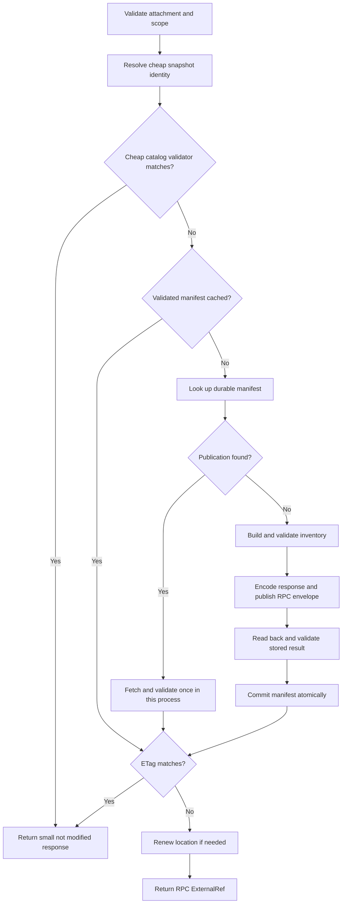

# VGI catalog batching and published snapshots plan

Approved implementation scope, reviewed 20 October 2026. Development
implementation and verification are recorded in
[catalog_contents.md](catalog_contents.md#development-verification-and-release-dependencies),
including measured sizes and the dictionary-encoding comparison. The allocated
wire revision is **2.2.0**. Package publication and deployment remain release
steps.

Keep the protocol name **`vgi.v2`**, advance the wire contract to the **next minor revision** (currently targeting **2.2.0**), and encode a complete catalog as six catalog-wide metadata streams. Add an opt-in framework facility that builds, validates and publishes an immutable catalog result once, persists its reference, and serves later requests without rebuilding, serializing, compressing or uploading the catalog. A worker restart should be able to recover the publication from storage.

The first release keeps the existing argument schemas, column schemas and typed default payloads intact. Following the measured comparison and approval on 21 October, `FunctionInfo.arguments`, `output_schema`, and `parameter_default_values` use `dictionary<int32, binary>` in the still-unreleased 2.2 contract. Other binary fields and field-level schema sharing remain unchanged. Framework authors implement reusable collection codecs and snapshot management; catalog authors continue supplying ordinary metadata objects, plus an explicit identity and sharing policy when they enable publication.

## Decisions and approval status

1. Use six streams spanning all schemas: schemas, tables, views, functions, macros and indexes. Keep the metadata values, remove the schema attach handle described below, and dictionary-encode the three approved FunctionInfo binary fields.
2. **Approved:** remove `SchemaInfo.attach_opaque_data` from the new wire record. Preserve `CatalogAttachResult.attach_opaque_data`, attachment data on subsequent requests, and worker access during function execution. Removing only the schema copy makes otherwise identical metadata reusable across attachments.
3. Provide ordinary delivery and published delivery as framework options. Preserve the current default behavior until a worker opts into published delivery.
4. Make a durable publication manifest part of the feature, so reuse can survive worker restarts. An in-memory reference cache alone does not meet that requirement.
5. Validate a newly published object by retrieving and decoding it before registering it for reuse. Validate imported publications once before use in each process, rather than on every request.
6. Require explicit snapshot scope and a stable revision for shared publications. A catalog version or content hash alone is not an authorization boundary or a sufficient discovery key.
7. Release support in Python, TypeScript, Go, Rust, Java and C#, together with the native and WASM consumers. Keep C and the separate C++ worker SDK explicitly on their existing wire revision until their ports are complete; they require consumers that support that revision.
8. **Approved:** use the next minor wire-contract revision under `vgi.v2`. Preserve exact major/minor matching and the existing routing name. Coordinate the revision number with other pending wire changes before implementation.

## Existing support and the work still needed

VGI already has catalog-wide loading, ETag revalidation and selected in-process snapshot caches. Python and TypeScript keep the catalog author's typed inventory separate from its wire encoding. Other implementations commonly compose the whole response from serialized per-schema listing items. Several metadata readers only consume row zero.

All six local vgi-rpc implementations support pre-published unary results:

| Framework | Publication API | Returning the reference |
| --- | --- | --- |
| Python | `publish_external` | Return `ExternalRef` from the implementation |
| TypeScript | `publishExternal` or `publishExternalResult` | Return `ExternalRef` from the handler |
| Go | `PublishExternal` or `PublishExternalResult` | `CallContext.RespondWithExternalRef` |
| Rust | `publish_external` | `RefOr::Ref` or `CallContext.respond_with_external_ref` |
| Java | `Externalizer.publishExternal` | `CallContext.respondWithExternalRef` |
| C# | `ExternalLocation.PublishExternalAsync` | `ICallContext.RespondWithExternalRef` |

These APIs bypass ordinary result construction and validation when returning a reference. They also bypass the ordinary externalized-response upload cap, because that request uploads nothing. They do not provide VGI catalog validation, cache identity, invalidation, durable manifest discovery or URL renewal. Those are the main additions proposed here.

The basic RPC storage interface uploads bytes and returns a URL. It does not generally return an object identifier, URL expiration or manifest transaction primitives. The VGI facility therefore needs a small publication repository alongside that interface; the detailed contract appears below. Existing RPC codecs, compression, pointer messages and fetchers should be reused.

Source checkouts are not proof of released dependency availability. For example, the Python checkout currently uses a development RPC dependency and an editable sibling checkout; Java and C# can substitute sibling sources. Release verification must also build against packaged dependencies without those substitutions.

## Expected benefits and measurement limits

The six-stream prototype produced the following gzip sizes. kB and MB are decimal.

| Catalog | Schemas | Functions | Tables | Original gzip | Six-stream gzip | Reduction |
| --- | ---: | ---: | ---: | ---: | ---: | ---: |
| GitHub | 3 | 804 | 2 | 517.8 kB | 188.3 kB | 63.6% |
| Cloudflare | 24 | 1,690 | 237 | 2,033.0 kB | 953.6 kB | 53.1% |

Uncompressed sizes fell from 12.19 MB to 4.62 MB for GitHub and from 25.23 MB to 8.26 MB for Cloudflare. These measurements include the fixed six-stream envelope and its empty categories, but exclude the outer RPC envelope and HTTP headers. They precede the proposed removal of the schema attach handle. These catalogs do not measure the savings for views, macros, indexes or other function kinds.

Batching reduces bytes and per-object IPC framing. Publication additionally removes catalog construction, serialization, compression and upload from warm requests. It does **not** eliminate the client's first object download: an external answer ordinarily involves the catalog RPC plus a storage fetch. A matching catalog ETag can avoid that download by returning `not_modified` inline. Client disk caching and CDN caching are separate optimizations, not assumptions behind this plan.

A local publication probe used the 8,256,520-byte Cloudflare prototype inside the actual RPC `result: binary not null` envelope. For both uncompressed and zstd delivery, one upload supported three successful HTTP resolutions. The resolver rejected an incorrect outer schema and modified object bytes. It accepted a correctly hashed envelope containing invalid catalog bytes, as expected: RPC does not interpret VGI's embedded payload. This establishes the publication building block, not six-framework conformance for the new catalog contract.

## Batched catalog wire contract

The method remains a unary call:

```text
catalog_contents(attach_opaque_data: binary, if_none_match: utf8?)
    -> CatalogContentsResponse

RPC envelope: one row, result: binary not null

CatalogContentsResponse: one row
    catalog_version: int64
    etag: utf8?
    not_modified: bool
    schemas: binary?
    tables: binary?
    views: binary?
    functions: binary?
    macros: binary?
    indexes: binary?
```

Each non-null category contains one complete Arrow IPC stream using that category's metadata schema. `functions` contains every function subtype, preserving its existing subtype field; `macros` contains both macro kinds. Objects retain their raw, component-wise schema paths. Do not join paths with a separator or deduplicate objects by unqualified name.

The six streams are separate because their row types differ. Each stream can contain multiple record batches. The writer chooses bounded batch sizes; readers must handle all rows and all batches, including dictionary messages. Publishing the response does not change this: the **outer published RPC stream contains exactly one one-row result batch**, while its nested metadata streams may contain many batches.

For a full response, null means the category has no objects. Writers use null for empty categories; readers may also accept a correctly typed zero-row stream as empty. A populated category is always complete. Unknown or unsupported content must not be represented as empty. Schema rows preserve parent-before-child order. Objects can be grouped by schema for efficient indexing, but readers do not rely on that grouping for correctness.

For `not_modified = true`, every category is null and the returned ETag must equal a non-null `if_none_match`. `catalog_version` remains current under the existing version rules. Transaction-local DDL continues using the existing transactional lookup and invalidation paths; published snapshots describe committed metadata.

Protocol name and version come from the canonical Python declaration and generated artifacts. Keep `vgi.v2` and advance the minor wire-contract version when replacing the response shape and removing the schema attachment field. Update reflection, protocol versions and hashes, client defaults and generated registries together. Preserve the existing HTTP protocol path. Changing only a package version is insufficient. No additional health request or format-probing RPC is needed.

Future representations can be introduced through an explicit protocol revision. Do not reserve unused field pools, default-value pools or arbitrary extension maps in this contract merely to anticipate them. Separating the SDK inventory, codec and publication layers provides the useful preparation for future improvements.

### Approved versioning decision

The Python declaration and native generated header inspected on 20 October both declare `2.1.0` under `vgi.v2`. The next minor is therefore `2.2.0`. Every ordinary request carries `vgi_rpc.protocol_version`; the server requires an exact major/minor match and ignores patch. These are separate from SDK package versions, catalog data versions and the underlying vgi-rpc framing version. This proposal does not require changing RPC framing.

Use the next minor as a coordinated wire-contract revision, including the breaking catalog representation changes. Update the canonical version-policy documentation during implementation so it explicitly permits this use of minor revisions; its current additive-only wording does not describe the approved decision. Leave the exact-match dispatch gate intact. A `2.1` client and a `2.2` worker remain incompatible despite sharing the routing name.

The query-pushdown proposal also targets `2.2.0`. At contract freeze, either include both changes in one explicitly defined revision or allocate successive minor revisions. If another wire change ships first, advance this feature to the next available minor. Never publish different schema contracts under the same major/minor pair, and do not add this change silently to an already released revision.

A patch-only bump is unsuitable because patches do not trigger the mismatch gate. A new format field inside `catalog_contents` alone would not protect older readers or version the ordinary schema-listing response. During migration, use matched client/worker artifacts and separate deployment base URLs for old and new revisions. The shared `vgi.v2` routing name does not select between revisions; serving both at one endpoint would require an explicit compatibility implementation outside this plan.

## Separate attachment context from reusable metadata

The current `SchemaInfo` has an `attach_opaque_data` field. Other core catalog object records inspected here do not all carry that field; the older catalog design's statement that every item embeds an attach handle is too broad for the current implementation.

GitHub explicitly disables attach-independent catalog caching because its schema record embeds per-attach auth and cache configuration. The native `ParseSchemaInfo` does not use that handle; subsequent calls already use their attached catalog context.

The removal is approved. Remove the field from the canonical **new `SchemaInfo` wire schema**, including ordinary schema-listing results, so there is one schema metadata representation. Keep `CatalogAttachResult.attach_opaque_data`, the client's stored attachment context, attachment data on catalog and function requests, and the worker's `params.attach_opaque_data` access. Inventory adapters can temporarily accept a legacy author-side field and exclude it from encoding; do not force every Python catalog constructor to change at once solely to discard redundant bytes. Generated wire records and new author APIs should not require it.

This does not automatically make a catalog public or independent of its caller. Comments, tags, visible objects, options and nested opaque payloads can still vary. Audit GitHub, Cloudflare and Open-Meteo before enabling broader sharing. Preserve the existing opt-out until each catalog establishes that its remaining metadata is independent of the removed handle. Client APIs that exposed the handle through `SchemaInfo` need an explicit migration to the attachment object.

## Writer and reader architecture

Use one logical inventory of ordinary `SchemaInfo`, `TableInfo`, `ViewInfo`, `FunctionInfo`, `MacroInfo` and `IndexInfo` records. Existing schema-grouped author APIs may feed that inventory without changing. The collection encoder produces the six streams, and the unary encoder wraps them in the response.

Add reusable collection encode/decode helpers rather than changing every unary record codec to accept arbitrary row counts. Reuse existing field conversions, enum spellings, deterministic map ordering and metadata validation. Leave embedded argument schemas, output schemas, table columns, typed defaults, examples and table operation descriptors intact.

For standard producers, build arrays directly from records. For custom hooks that currently return serialized items, supply an SDK adapter that reads their Arrow arrays and combines them. It must validate compatible schemas and unify dictionaries; concatenating IPC byte strings is not sufficient. This adapter is a migration path, not the target hot path for built-in producers. Avoid reconstructing every catalog field through a second handwritten serializer.

Both Python and TypeScript already memoize individual encodings. New collection code must account for that: removing the per-item encoding cost on cold builds is useful, but repeatedly decoding cached item bytes can regress warm, uncached requests. Benchmark direct construction and the adapter separately.

On clients, retain the shared snapshot buffers, index objects by raw schema path and kind, and materialize catalog entries lazily. Opening a category stream should happen once per snapshot, not once per schema. Reuse row-aware parsers where available; use zero-copy row slices only as an interim adapter for singleton parsers. Preserve function overloads and all table-function variants when splitting the combined function inventory into the native entry sets.

## Framework publication option

The following names illustrate the common API semantics; each SDK should use its language's conventions:

```text
CatalogSnapshotPolicy
    delivery: ordinary | published
    repository: CatalogPublicationRepository       # required for published
    identity: request context -> SnapshotIdentity  # required for published
    on_publication_failure: error | ordinary      # default error

SnapshotIdentity
    catalog_namespace
    source_revision
    visibility_scope
    catalog_version
```

`ordinary` preserves normal response delivery and existing caches. The transport may still apply its ordinary size-based externalization. `published` uses the new snapshot manager and returns a pre-published RPC reference; a low transport threshold alone does not enable this facility.

`source_revision` must change whenever any published metadata changes. It can be a catalog generation, schema revision or deployment identifier. It must be cheap to obtain before building the inventory. A static catalog can use a framework-supplied implementation/build identity plus its resolved catalog options. A dynamic catalog provides a revision hook. A version-zero catalog with no usable revision must not gain indefinite reuse just because publication was enabled.

`visibility_scope` states which requests may receive identical metadata. The safe default is attachment-local. Public or tenant/principal-scoped reuse requires an explicit catalog declaration. Scope includes any options, selected data/implementation version, locale or other settings that change metadata. Use opaque or hashed scope identifiers in storage keys; do not place credentials in object names or diagnostics.

Every request validates its attachment and authorization before consulting the cache. A cache hit does not authorize a request. The author supplies the semantic scope; the framework cannot infer visibility equivalence merely by examining a catalog name or integer version.

Expose framework helpers to warm a snapshot, import an already-published descriptor and invalidate a specific publication. Catalog authors should not need to construct the RPC envelope or return a bare `ExternalRef` themselves. Importing a descriptor follows the same retrieval and validation path as repository recovery. This supports startup warming, deployment-time publication of static catalogs and operational repair.

## Persistent publication repository

The large object and the discovery manifest serve different purposes. The object contains the immutable RPC result. The small manifest allows a later process to find it **before** rebuilding the catalog.

Use a cache key derived from the protocol name, major/minor wire-contract revision, canonical contract hash, catalog codec revision, catalog namespace, source revision, visibility scope and the actual `catalog_version` encoded in the result. The wire revision must participate even though the routing name stays `vgi.v2`; published catalog bytes must not cross incompatible revisions. Include the storage/compression profile in publication identity where different representations or credentials require separate publications. IDs and versions supplied by callers must be encoded unambiguously before hashing.

Do not use `catalog_version` alone as a cross-session key. It may be session-scoped. If two sessions require different versions in the response, they cannot reuse the exact same published envelope even when their object lists match. Cross-session reuse needs an explicitly shared revision and compatible version semantics; otherwise retain attachment-local publication.

The durable manifest records:

- Its cache key and format/validator revision.
- The protocol name, major/minor wire revision, contract hash and catalog codec revision.
- The catalog version and ETag in the immutable full response.
- The raw RPC-envelope SHA-256 and raw/stored sizes.
- An opaque storage object identifier when available, the retrieval reference and its expiration.
- Object retention limits and publication validation status.

Store manifests in a trusted, access-controlled repository. Treat signed URLs in them as credentials. An ordinary content hash does not authenticate a manifest or its scope.

The repository needs these capabilities:

| Operation | Purpose |
| --- | --- |
| Lookup a manifest by key | Recover a publication without rebuilding metadata |
| Supply an RPC `ExternalStorage` uploader | Reuse `publish_external` and equivalent serializers |
| Commit a validated manifest atomically if absent | Never expose a partially uploaded or unvalidated result |
| Invalidate a particular manifest conditionally | Avoid deleting a replacement installed by another publisher |
| Renew a retrieval reference, when supported | Refresh a signed URL without serializing or uploading the object again |

A URL-only storage adapter can work if it declares the URL lifetime or explicitly guarantees a stable location. Unknown expiry is not a basis for indefinite reuse. If it cannot renew a URL, it can republish at expiration; that is a periodic rebuild, not a per-request operation. A backend with an object identifier and signing API can renew without rebuilding and is preferred for high-performance deployments.

Keep vendor storage operations in adapters and reuse existing RPC storage packages. Supply a memory repository for local use and a durable reference adapter for S3-compatible storage, suitable for S3/R2 deployments. All six frameworks need the same repository semantics and a working durable fixture; bespoke cloud serialization code does not belong in their catalog handlers. Determine whether shared storage primitives belong in each RPC package during the first implementation phase, without moving VGI-specific scope or validation rules into RPC.

Coordinate concurrent builds once per key within a process. Atomic manifest commit makes concurrent publishers converge on one valid publication, but may still allow duplicate initial uploads across processes. A distributed lease can reduce that cost for a repository that supports it; do not claim a global exactly-once guarantee from a local mutex. Unreferenced losing uploads are collected through storage lifecycle rules.

## Publication and request lifecycle



Preserve the existing cheap catalog ETag short circuit when one is available: a valid `not_modified` answer does not require creating a publication. Do not equate a source revision with an ETag unless the catalog explicitly defines that relationship. When only a persisted manifest supplies the ETag, its recovery and validation rules still apply.

The first build takes a consistent committed snapshot. For catalogs without a transactional snapshot API, read the generation before and after collection and discard/retry a build whose generation changed. Bound retries and surface persistent churn rather than publishing mixed generations. A catalog's existing snapshot provider may supply the equivalent consistency guarantee directly.

Validate the logical inventory, encode the streams and assign a catalog ETag before publication. Retain a catalog-supplied ETag when valid; otherwise derive an opaque validator from an unambiguous, versioned digest of the catalog version and six stream payloads, excluding the ETag itself. Deterministic order is required within a writer. Equivalent catalogs from different Arrow implementations need not produce byte-identical IPC or identical generated ETags.

The external SHA-256 is different: it covers the complete uncompressed **outer RPC envelope**. It protects retrieved bytes, including the encoded catalog ETag. Signed URL changes do not change either validator.

Publish using the existing RPC helper. Retrieve the resulting object through the normal bounded resolver, validate its outer envelope, decode the catalog payload, and verify version, ETag, complete inventories and metadata against the snapshot being published. Only then commit the manifest. Do not mark it ready merely because an upload succeeded or a HEAD request returned 200.

After validation, the worker may discard the large encoded body and retain only the identity, manifest and indexes required by its own catalog implementation. The publication layer should not pin an extra full copy unnecessarily. Bounded caches prevent unbounded accumulation of attachment-scoped manifests.

A warm request performs attachment checks, cheap revision/scope lookup and a manifest lookup. If its ETag matches, return `not_modified` inline without accessing the object. Otherwise ensure the retrieval location remains usable and return the reference. No full catalog serialization, compression, upload or read-back occurs on this warm path. A cold process with a durable hit performs one read-back validation, but no catalog build or upload.

Never serialize a new `catalog_version` around a reference to an old version's envelope. Revision changes select a new manifest. A publication racing with invalidation may be stored under its old immutable key, but must not replace the manifest for the new revision or become the active response for it.

## Expiration and failure behavior

Refresh signed URLs before expiration with enough margin for the configured fetch/retry deadline and clock skew. Persist refreshed references conditionally. Keep old immutable objects available for the lifetime of issued references plus the allowed fetch grace period; invalidation must not delete an object that an in-flight client is fetching.

Storage TTLs must distinguish durable catalog publications from short-lived per-call RPC uploads. Apply limits to raw catalog size, stored size, download size and decompression size. Enforce publication byte limits before upload: extend the RPC publication helper or supply a bounded uploader as needed, reusing its serialized bytes rather than serializing again just to count them. RPC's per-request externalized-upload cap does not enforce these limits for a pre-published reference.

Published mode defaults to an explicit error when publication or recovery fails. An operator may enable ordinary-response fallback, but only for a valid snapshot of the requested revision. A validation failure must not make an invalid result acceptable inline. Never substitute another tenant's publication, an unrelated version or an expired reference as fallback.

A missing object detected during repository recovery, renewal or validation invalidates its manifest and triggers bounded rebuild/republication. A checksum or schema mismatch marks the publication unusable and is observable as a validation failure. A client's independent storage GET failure does not automatically notify the worker; it follows the client's bounded error/fallback behavior, and the publication can be repaired through the framework invalidation helper. Do not promise automatic repair on the next request without a detection mechanism. Preserve existing client fallback rules where appropriate, but conformance must detect fallback so it cannot hide a broken bulk or externalized path.

Client resolvers retain their existing URL policies, redirect limits and encoded/decoded size caps. Require SHA-256 for framework-managed catalog publications, even though RPC permits a missing digest. Do not forward worker authentication headers to storage URLs. Choose a storage content encoding supported by the intended consumers and include that profile in publication identity. Browser deployments require an accessible storage origin with correct CORS and content-encoding behavior. A server-side read-back cannot establish that Safari or the WASM consumer can fetch the object; that needs a browser verification lane.

## Framework implementation map

| Component | Main changes | Relative effort |
| --- | --- | --- |
| Python | Canonical metadata types and version policy; collection codec; inventory and publication manager; server configuration; client decoding; MetaWorker version propagation; generator outputs | Moderate |
| TypeScript | Collection ASD codec using the Arrow facade; both backends; publication-aware handler return types; durable manifest support; client load path | Moderate |
| Go | Refactor singleton metadata builders to append records; adapt encoded hooks; integrate publication through the existing call context; preserve attach checks | Moderate to substantial |
| Rust | Collection support around `VgiArrow`; producer/dispatcher changes; carry call context into publication path; preserve native/WASM feature boundaries | Moderate |
| Java | Collection record marshalling; preserve service decorators and catalog providers; publication manager through call context; allocator ownership | Moderate to substantial |
| C# | Collection codec and dictionary unification; preserve composer overrides; publication through call context; buffer disposal | Moderate to substantial |
| Native and WASM consumer | Updated wire-version/schema validation under `vgi.v2`; multi-row and multi-batch decoding; schema/kind indexes; shared snapshot ownership; external result validation | Moderate to substantial |
| SDK generators | Regenerate schemas, DTOs, protocol versions, method registries and reflection; retain protocol names; extend collection helpers without copying metadata definitions | Cross-cutting |

The six VGI handlers already have return-value or call-context mechanisms suitable for their RPC reference APIs, although some paths need that context threaded through. Keep the declared RPC result as `CatalogContentsResponse`; the transport reference is an alternative delivery mechanism, not a new catalog return schema.

Underlying metadata codecs need correct dictionary handling even without optimization #4: existing function and macro enum columns are already dictionaries. The approved three-field addition extends string-only helpers and generators to support `dictionary<int32, binary>`, including byte-content deduplication, null and empty values, and dictionary replacement between batches. It applies to singleton and collection FunctionInfo encodings while preserving author APIs. Field pooling and decoded-object sharing remain separate work.

## Verification and acceptance criteria

Use the existing catalog conformance and RPC external-reference suites as the foundation. Update shape-specific expectations and extend their fixtures where the new behavior needs coverage. Do not create a second independent catalog serializer as the correctness oracle.

| Area | Required evidence |
| --- | --- |
| Metadata equivalence | Every object and field matches the existing per-schema path, including docs, tags, examples, typed defaults, constraints and embedded schema metadata |
| Complete object coverage | Schemas, tables, views, every function subtype, both macro kinds and indexes; no category silently omitted |
| Batch handling | Multiple schemas, repeated names, overloads, empty categories, multiple batches and differing dictionary values; later rows/batches are never dropped |
| Reader interoperability | Every writer through the native consumer and Python reference decoder; Python-produced fixtures through the other public client decoders; TypeScript on both Arrow backends |
| Version behavior | New contract/version/hash parity with `vgi.v2` unchanged; explicit rejection of both older and newer minor peers; no successful mixed-version decoding or publication reuse |
| Publication | Ordinary and published results decode identically; one upload and one build for repeated calls within a process and unchanged identity |
| Warm performance | Instrumented warm requests perform zero full catalog builds, encodes, compressions, uploads and read-back downloads |
| Durable recovery | A fresh worker recovers the manifest, validates once, and serves without rebuilding or uploading |
| Conditional requests | Matching ETag returns inline `not_modified`, with no client storage fetch and no publication work |
| Isolation | Distinct attachments, tenants, options and selected versions share only under the declared equivalence policy |
| Invalidation | Metadata/DDL generation changes create a new publication; old in-flight references remain usable; concurrent changes do not mix generations |
| Lifecycle | URL renewal, non-renewable adapters, expired/missing objects, storage outage, simultaneous cold requests and failed publication cleanup |
| Malformed objects | Wrong outer schema/row count, bad digest, nested external pointer, wrong inner schema, missing/extra required content, inconsistent paths/version/ETag and oversized data |
| Transports | HTTP and subprocess external retrieval in all six languages; representative supported Unix/Iroh paths; native DuckDB and actual Cupola WASM browser fetches |

The existing `catalog_contents_conformance.test` compares SQL-visible bulk and per-schema results and checks RPC counts. That is useful but not enough to establish equality of metadata that DuckDB does not expose. Add record-level comparisons to the existing fixture workflow. Keep existing fallback, revalidation, version and DDL cases.

Run generated-schema parity and the six-language integration matrix after the wire change. The root `make test_languages` currently covers Python, Go, Rust, TypeScript, Java and C#; it does not cover the separate C or C++ worker SDKs. Use actual non-skipped counts, release builds and saved logs. Verify packaged dependency builds as well as sibling-source development builds.

Benchmark GitHub, Cloudflare and Open-Meteo using cold builds, warm uncached ordinary delivery, memory-cached delivery, new publication, reused publication, restarted-worker recovery and ETag hits. Record construction time, encoding/compression time, upload and retrieval counts, peak memory, transferred bytes and client decode time. Compare adapter-based writers with direct collection writers. Set regression thresholds from these baselines rather than promising a latency percentage from payload-size measurements.

## Implementation sequence and release gates

1. **Freeze the contract and repository semantics.** Allocate the next minor revision under `vgi.v2`, coordinate with other pending wire changes, and update the documented version policy. Specify the batched schemas, schema attachment-field removal, scope/revision rules, manifest format, expiration behavior and error policy. Establish the exact released RPC dependency floor per language. Settle the durable adapter APIs before implementing six divergent versions.
2. **Build the Python reference and native reader.** Implement collection encoding and decoding, generated contracts and context separation. Exercise every metadata kind before expanding publication. Preserve per-schema semantic equivalence and native lazy entry loading.
3. **Implement publication in the reference framework.** Add policy injection, process-local coordination, durable manifest lookup, validation/read-back, recovery, invalidation and expiry handling. Exercise ordinary and external answers through the real native consumer. Publish helper functions for warming and importing artifacts.
4. **Port the same abstractions to the other five frameworks.** Reuse existing metadata producers and RPC publishers. Add collection helpers in shared codec packages where necessary. Run each port against the common fixtures as it lands; do not postpone interoperability until the final port.
5. **Verify package and browser integration.** Run the six-language matrix, storage/lifecycle cases and performance scenarios. Rebuild native/WASM artifacts and SDK clients. Verify Safari/Chromium retrieval from the actual storage deployment, including CORS, compression and URL expiry.
6. **Stage the new minor revision and release together.** Publish required RPC support first, then SDK packages and consumer artifacts. Bring up new-revision workers at separate deployment base URLs alongside the previous revision; both retain the `vgi.v2` protocol path. Move test/demo catalogs, then Cupola and production workers with matching consumers. Keep previous-revision deployments and artifacts available during the migration window; this plan does not require every new SDK to contain a permanent legacy encoder.
7. **Enable publication catalog by catalog.** Begin with a static catalog whose metadata is explicitly shareable. Enable GitHub only after auditing its context-dependent fields and revision policy. Observe build/upload counts, manifest hit rate and fetch failures before broad rollout.

The minor bump changes the version gate for all VGI methods even though catalog metadata motivates it. Audit version constants and endpoint selection in launchers, proxies, test wrappers, deployment configuration and published browser bundles; keep `vgi.v2` routing references intact. Roll back consumers and workers together to the retained matching deployment/artifact set. Do not point a new-revision consumer at an old-revision worker or reuse its publication manifest.

Initial delivery is complete when all six writers and supported consumers meet the metadata and external-publication gates, durable recovery works, warm requests have the required zero-work counters, and dependency-package/browser runs pass. Field pooling, default deduplication, a new client disk cache, distributed exactly-once publication and the C/C++ worker ports are separate follow-ups.

## Review choices and scope boundaries

The schema attachment-field removal and next-minor versioning approach are approved. Attachment state and its request/execution plumbing remain part of the contract. The routing name stays `vgi.v2`; exact release-number allocation is coordinated at contract freeze.

The operational defaults are opt-in publication, attachment-local scope unless declared otherwise, mandatory validation/read-back, mandatory digest, and errors on publication failure unless ordinary fallback is explicitly enabled. The first durable reference backend is S3-compatible storage. These defaults are now implemented in the six SDK development checkouts.

Exact elapsed implementation time should be estimated after the collection-codec and durable-repository reference work. The main uncertainty is shared codec work in Go/Java/C#, plus packaged dependency and browser behavior; the six-stream wire shape itself is comparatively small. Publication lifecycle work is substantial and should not be folded into a payload-only optimization estimate.

## Source references

The paths below refer to the local source checkouts reviewed for this plan.

| Subject | Primary source |
| --- | --- |
| Current protocol name, version and bump rules | [Python VgiProtocol](../../vgi-python/vgi/protocol.py) |
| Version enforcement and revision coordination | [RPC dispatch gate](../../vgi-rpc-python/vgi_rpc/rpc/_server.py), [RPC metadata](../../vgi-rpc-python/vgi_rpc/metadata.py), [query-pushdown proposal](../../vgi-python/docs/protocol/vgi-catalog-query-pushdown-design.md) |
| Python inventory and snapshot encoding | [Catalog interface](../../vgi-python/vgi/catalog/catalog_interface.py), [worker](../../vgi-python/vgi/worker.py), [server construction](../../vgi-python/vgi/rpc_server.py) |
| TypeScript codec, cache and handlers | [ASD codec](../../vgi-typescript/src/codec/asd.ts), [catalog contents](../../vgi-typescript/src/protocol/handlers/catalog/contents.ts) |
| Go and Rust composition | [Go catalog contents](../../vgi-go/vgi/catalog_contents.go), [Go metadata encoding](../../vgi-go/vgi/catalog_types.go), [Rust dispatch](../../vgi-rust/vgi/src/dispatch.rs), [Rust wire helpers](../../vgi-rust/vgi-protocol/src/wire.rs) |
| Java and C# composition | [Java CatalogContents](../../vgi-java/vgi/src/main/java/farm/query/vgi/CatalogContents.java), [C# composer](../../vgi-csharp/src/QueryFarm.Vgi/Internal/CatalogContentsComposer.cs), [C# embedded IPC](../../vgi-csharp/src/QueryFarm.Vgi/Internal/EmbeddedIpc.cs) |
| Python RPC publication and resolution | [External APIs](../../vgi-rpc-python/vgi_rpc/external.py), [external documentation](../../vgi-rpc-python/docs/api/external.md), [wire protocol](../../vgi-rpc-python/docs/WIRE_PROTOCOL.md) |
| Other RPC publication implementations | [TypeScript](../../vgi-rpc-typescript/src/external.ts), [Go](../../vgi-rpc-go/vgirpc/external_ref.go), [Rust](../../vgi-rpc-rust/vgi-rpc/src/external.rs), [Java](../../vgi-rpc-java/vgirpc/src/main/java/farm/query/vgirpc/external/Externalizer.java), [C#](../../vgi-rpc-csharp/src/QueryFarm.VgiRpc/External/ExternalLocation.cs) |
| Existing conformance | [Catalog SQL conformance](../test/sql/integration/catalog/catalog_contents_conformance.test), [Python catalog cases](../../vgi-python/tests/catalog/test_catalog_contents.py), [RPC external reference cases](../../vgi-rpc-python/vgi_rpc/conformance/_external_pytest.py), [language matrix](../Makefile) |
| Generation and parity | [Regeneration driver](../../vgi-python/scripts/regen_generated.py), [schema parity](../scripts/check_schema_parity.sh) |
| Native catalog and external readers | [Catalog API](../src/vgi_catalog_api.cpp), [catalog snapshot ownership](../src/include/vgi_catalog_metadata.hpp), [external resolver](../src/vgi_http_client.cpp) |
| Attach-dependent example | [GitHub catalog](../../vgi-github/vgi_github/worker.py) |

Research artifacts are `/tmp/catalog-batching-study/` for the serialization measurements and `/tmp/vgi-catalog-publication-research/` for the publication probe. The stable findings and acceptance criteria are recorded above; those temporary artifacts are not production code or a replacement for the release verification matrix.
